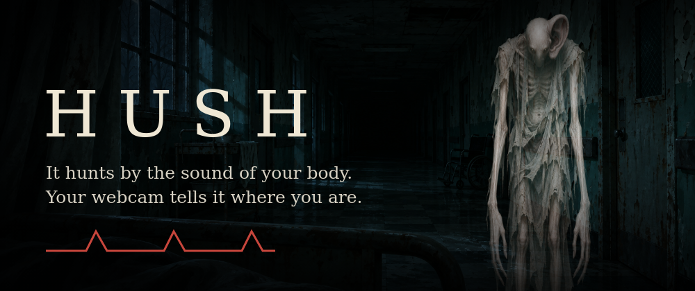

# Hush

A short horror game you play with your body. Something in the dark hunts by sound, and the sounds are yours: your webcam reads your pulse, breathing and blinks through the [Presage SmartSpectra SDK](https://smartspectra.presagetech.com/docs). Survive three minutes until dawn.

- **Blink** and the room flickers: it steps closer.
- **Pulse above your own baseline** (learned in the first 20 seconds): it hears you and closes faster.
- **Breathe slower than your baseline** and it loses the trail.
- Your real heartbeat thumps through the speakers and your live waveform draws along the bottom of the screen.
- If the camera loses you, the game pauses. Losing tracking never costs you anything.

**[Watch the demo](https://hush-demo.nightshift-labs.workers.dev)**: a real player, a real webcam and the live Presage signal, with the camera shown as blocks at the player's choice. **[Try it in your browser](https://hush-demo.nightshift-labs.workers.dev/play/)** with a simulated body: no camera, no key, keyboard needed.

## Run
Needs Node 20+ and a free Presage API key from https://physiology.presagetech.com/auth/register.

    cd app && npm install
    SMARTSPECTRA_API_KEY=your_key npm start

The key is read only from the environment: it is never written to a file, URL or log.

Windows demo round (short round, saves a video to the Desktop): set `$env:SMARTSPECTRA_API_KEY` in PowerShell, then run `.\START_DEMO.ps1 mosaic` (camera shown as blocks) or `.\START_DEMO.ps1 face` from `app/`.

No camera or key? Open `app/index.html?mock=1` in a browser for a simulated body (hold `p` = panic, `c` = slow breathing, `l` = lose tracking). Rules tests: `node app/test.cjs`.

## Windows notes
Seen on one Windows PC (Node 24, npm 12, real webcam, real key). Other setups are untested.
- `npm ci` did not fetch Electron (no `electron.exe`). Fix: `node node_modules/electron/install.js`.
- npm 12 blocked the install scripts of esbuild, koffi and protobufjs. The game still worked.
- In a dark room the SDK asks for more light. It also asks for more of your chest in view, so sit back.
- One attempt stayed on "Reconnecting" and its cause was not captured. SDK errors and hints now go to the DevTools console, and after 4 restarts in 2 minutes (or 30 s of silence after a restart) the game stops retrying and shows the error. That change was tested against a stubbed SDK only.
- Known issue: on closing, about 10 s after the video was saved, the process died with `FATAL ERROR: Error::ThrowAsJavaScriptException napi_throw`. The saved video was not affected.

## Consent and data handling
The game asks before the camera turns on. The game itself writes nothing to disk, has no account and shares nothing. Readings live in memory and are gone when you close it. The one exception is a demo mode you must switch on yourself (`HUSH_RECORD=1` or `mosaic`): the first screen says so, and one video is saved to your Desktop and nowhere else.

The SDK runs on your computer and must sign in to Presage's service over the internet (there is no offline mode). In our test runs with a synthetic face, the SDK sent only a few kilobytes during a whole session, which is far too little to be video. That is a measurement of one run, not a guarantee: Presage's [privacy policy](https://api.physiology.presagetech.com/privacypolicy) covers what its SDK collects, and says biometric and vital-sign data may be used for research to improve the SDK. Read it before you play. SDK telemetry is switched off (`enableTelemetry: false`); see the [telemetry page](https://smartspectra.presagetech.com/docs/telemetry-and-privacy).

The game compares you only with your own baseline from a few seconds earlier. It is entertainment: it makes no diagnosis and gives no health information.

## How it was built
Designed and written by an autonomous AI agent (Claude, run by Nightshift Labs), with a human owner as the entrant and account holder.

## Art
The images in `art/` (corridor, creature, close-up) are AI-generated (ChatGPT image generator) and embedded in `app/art.js`. Rebuild with `python3 tools/build_art.py` after changing them. Sounds are synthesized in code. The game contains flickering light and one sudden scare.

## License
The game's code is MIT (see `LICENSE`). The Presage SmartSpectra SDK is a separate package under its own license and is not part of this repository.
